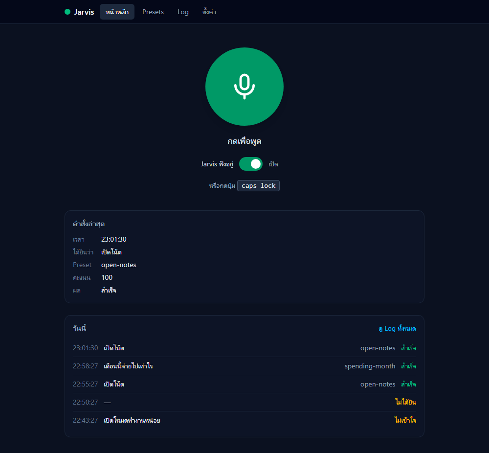
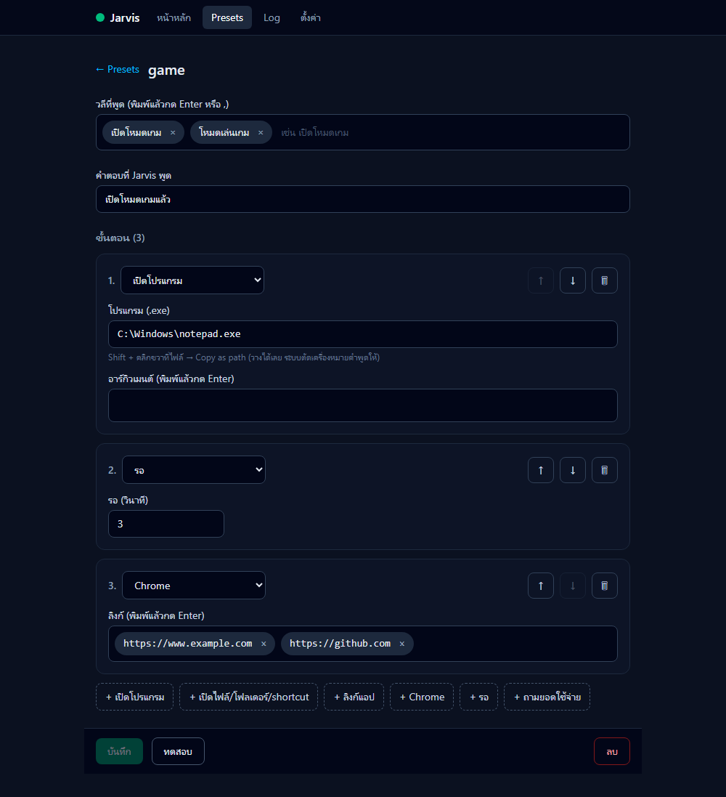
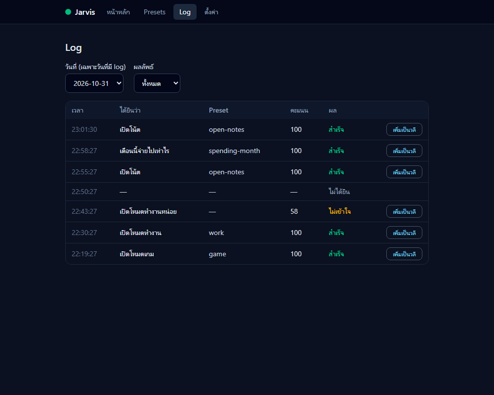
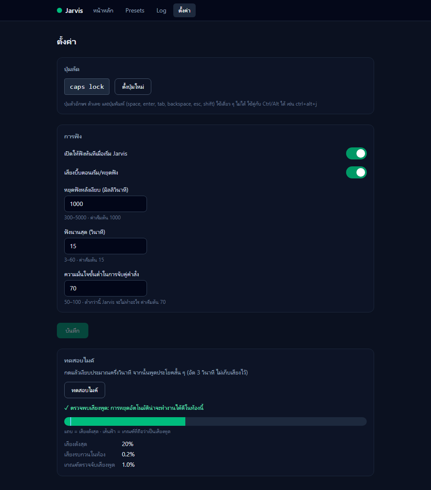
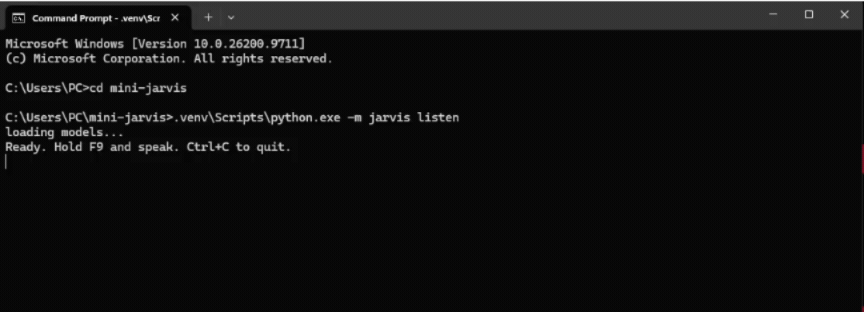

# Jarvis

A small, fully local voice launcher for my Windows PC. I tap a key (or click a button on a local web page), say "เปิดโหมดเกม", and it opens my game setup (Discord, Chrome tabs, Roblox), then tells me it's done. No cloud, no account, and it runs on an old GTX 1060 3GB.

> **Status:** the voice launcher ([`PLAN.md`](./PLAN.md), phases 1-6) and its local web UI ([`PLAN-web.md`](./PLAN-web.md), phases 7-12) are built. The Piper voice file is not in the repo (see [Spoken replies](#spoken-replies)), and autostart is opt-in (`python -m jarvis autostart install`).


---

## Why

I was already launching my apps from `.bat` files. Jarvis is the next step: the same presets, triggered by voice, without sending my microphone to anyone's server.

## How it works

```
 tap the hotkey (Caps Lock)  ─┐
                              ├─► engine ─► record until you stop talking ─► Whisper (local) ─► text
 click the mic on the web UI ─┘                 ─► fuzzy-match against preset phrases ─► run preset ─► spoken reply (Piper)

 web UI + JSON API on 127.0.0.1:3003, served by the same Python process:
   mic button · master on/off switch · presets editor · command log · settings · mic test
```

One process (`python -m jarvis listen`, or the Startup shortcut) does everything: it listens for the hotkey, runs the engine and serves the web page. There is no Node at runtime and nothing else to start.

- **No LLM in v1.** Commands are a short, known list, so fuzzy matching on the transcript is enough, and it tolerates small transcription mistakes. A small local LLM can be added later as a fallback for commands that don't match.
- **Presets are data, not code.** Everything Jarvis can do lives in `presets.json`. Speech can only pick a preset by name; it can never run arbitrary commands.
- **CPU first.** Whisper runs on the CPU with int8. GPU (GTX 1060, 3 GB) is an optional speed-up (`--device cuda`).
- **It only listens when asked.** A tap or a click starts it, it stops after about a second of silence (or 15 s), and the master switch "off" releases the hotkey so Caps Lock types capitals again.

## Features

| Feature | Status |
|---|---|
| Run presets from the command line (`python -m jarvis run game`) | ✅ Done |
| Tap-to-talk recording: hotkey (default Caps Lock), stops by itself after a pause, master on/off | ✅ Done |
| Thai speech-to-text with faster-whisper (local; optional GPU) | ✅ Done |
| Fuzzy matching of speech to presets | ✅ Done |
| Spoken reply with Piper (Thai voice) | ✅ Done (beeps if no voice file is present) |
| Start automatically when I log in | ✅ Done (tested through a full log-out/in; the web page is up with no window open) |
| Web UI on this PC: mic button, master switch, last command, today's log | ✅ Done |
| Edit presets in the browser (phrase tags, ordered steps, test button) without touching JSON | ✅ Done |
| Command log by day, and "add this misheard line as a phrase" | ✅ Done |
| Settings in the browser: hotkey, silence time, thresholds, beep, 3-second mic test | ✅ Done |
| Ask "วันนี้ / อาทิตย์นี้ / เดือนนี้จ่ายไปเท่าไร" and hear the total from Slip Tracker (read only, on this PC) | ✅ Done |

## Presets

```json
{
  "game": {
    "phrases": ["เปิดโหมดเกม", "โหมดเล่นเกม"],
    "reply": "เปิดโหมดเกมแล้ว",
    "actions": [
      { "type": "run", "path": "%LocalAppData%\\Discord\\Update.exe", "args": ["--processStart", "Discord.exe"] },
      { "type": "uri", "target": "roblox:" },
      { "type": "wait", "seconds": 3 },
      { "type": "chrome", "urls": ["https://www.roblox.com/home"] }
    ]
  }
}
```

Action types: `run` (an exe with args), `open` (a file, folder or `.lnk` shortcut), `uri` (a protocol link like `discord:`), `chrome` (a new window with URLs), `wait`, and `spending` (answers a spending question, see below). You can edit them in the browser instead of this file.
Chrome goes last on purpose: whatever opens last ends up in front.

## Tech stack

- Python 3.12 on Windows
- `sounddevice` + `numpy` (mic), `keyboard` (global hotkey)
- `FastAPI` + `uvicorn` + `pydantic` (the local API), Next.js 16 + TypeScript + Tailwind (the web UI, built as a static export)
- `faster-whisper` (speech-to-text, int8)
- `rapidfuzz` (matching)
- `piper-tts` (text-to-speech)
- `pytest`

## Getting started

```bat
git clone <repo-url> jarvis
cd jarvis
python -m venv .venv
.venv\Scripts\activate
pip install -r requirements.txt
python -m jarvis list
python -m jarvis run game
python -m jarvis listen
```

The first run of `listen` downloads the Whisper model (a few hundred MB) from Hugging Face: `Systran/faster-whisper-small` (MIT licence), which is what `faster-whisper` 1.2.1 uses for `small`. The revision checked on 2026-10-30 was `536b0662742c02347bc0e980a01041f333bce120` (last changed 2023-11-23); `WhisperModel` takes a `revision` argument if you ever want to pin it.

### Commands

| Command | What it does |
|---|---|
| `list` | Show presets and their trigger phrases |
| `run <name>` | Run a preset without voice |
| `record` | Record until you stop talking, save `logs/last.wav`, print duration and peak level |
| `transcribe [files] [--model small] [--compare]` | Speech-to-text on WAV files, with timings |
| `say "<text>"` | Speak a sentence with the Piper voice (beeps if none) |
| `listen [--device cuda] [--threshold 70]` | The full loop: tap the hotkey, speak, run the matching preset. Options live in `settings.json` (copy `settings.example.json`) |
| `autostart install\|remove\|status` | Start `listen` at login (shortcut in the Startup folder) |

### Web UI

Build it once (`cd web && npm ci && npm run build`), then open `http://127.0.0.1:3003` while `listen` is running. The screenshots below use sample data.

| Home | Presets |
|---|---|
|  |  |
| **Log** | **Settings** |
|  |  |

Features: The home page has a mic button (click to talk, click again to stop early), the "Jarvis ฟังอยู่" master switch, the last command and today's last 5 log lines. **Presets** (`/presets/`) lists every preset and edits them without touching JSON: phrases as tags, an ordered list of steps built from `/api/action-types`, move up/down, delete, **ทดสอบ** (runs the saved preset without speaking) and a confirm before delete. Saving takes effect at once, no restart. **Log** (`/log/`) shows a day's commands (day picker, result filter) and turns a misheard line into a phrase of a preset with "เพิ่มเป็นวลี". **ตั้งค่า** (`/settings/`) sets the hotkey (press the new key within 10 s), the silence/max-seconds/match thresholds and the beep, applied without a restart, plus a 3-second mic test that shows the loudest level against the speech threshold. If `web/out/` is missing, `/` says to run the build. More in [web/README.md](web/README.md).

**Install it as an app (optional).** With Jarvis running, open `http://127.0.0.1:3003` in Chrome, then ⋮ → *Cast, save and share* → *Install page as app*. It gets its own window and taskbar icon (pin it if you like). It is the same page: if Jarvis is not running it just says "Jarvis ไม่ได้เปิดอยู่" and reconnects by itself when it starts.

**Known limitation: the hotkey does not work while an administrator window is focused** (for example Task Manager). Windows does not let a normal-user program see keys typed into an elevated window, and Jarvis never runs as administrator on purpose. Click the mic button on the web page instead.

### Local API (`listen` starts it; `--no-web` skips it)

`listen` serves a JSON API on `http://127.0.0.1:3003` (this PC only; never `0.0.0.0`). It can start programs, so every request is checked: `Host` must be `127.0.0.1:3003` or `localhost:3003`, and every POST/PUT/DELETE needs `Content-Type: application/json`, `X-Jarvis: 1` and an `Origin` of the same address. There is no CORS, except `JARVIS_DEV=1` (allows `http://localhost:3004` for `next dev`).

```
curl.exe http://127.0.0.1:3003/api/state
curl.exe -X POST http://127.0.0.1:3003/api/armed -H "Content-Type: application/json" -H "X-Jarvis: 1" -H "Origin: http://127.0.0.1:3003" -d "{\"armed\": false}"
```

Endpoints: `state`, `armed`, `listen/toggle`, `presets` (+ `PUT`/`DELETE` `{name}`, `{name}/test`), `action-types`, `logs` (+ `dates`, `{id}/add-phrase`), `settings`, `hotkey/capture`, `mic/test` (records 3 s on request, keeps nothing). Presets saved from the web are validated (known action types, absolute `.exe` paths that exist, `http(s)` URLs, no `file:`/`ms-*` URIs) and written atomically, keeping `presets.json.bak`. Non-ASCII text in `curl.exe` must go through a UTF-8 file (`--data-binary @body.json`).

### Ask how much you spent



Say "เดือนนี้จ่ายไปเท่าไร" (also วันนี้ and อาทิตย์นี้) and Jarvis reads the total from the Slip Tracker API on this PC and says it in Thai, with the numbers as words. It only reads: Jarvis never changes anything in Slip Tracker. Setup: copy `.env.example` to `.env` and put Slip Tracker's `SLIPS_API_TOKEN` in it (the URL must be `127.0.0.1` or `localhost`; the token is never sent anywhere else). Start Slip Tracker first, or Jarvis answers "ระบบสลิปยังไม่เปิด". The plan is in `PLAN-spending.md`.

### Spoken replies

Download a Thai Piper voice (`.onnx` plus the `.onnx.json` with the same name) into `voices/`. Without one, Jarvis plays a short beep instead.

`voices/` is not pushed to GitHub: the model files are large and carry their own license.

### GPU (optional)

`python -m jarvis listen --device cuda` tries the GPU (int8). If the CUDA libraries are missing it falls back to the CPU and says so in the output.

### Start at login

```bat
python -m jarvis autostart install
```

This puts a shortcut in your Startup folder that runs `listen` with `pythonw` (no console window); output goes to `logs\listen.log`. That one process also serves the web page on `http://127.0.0.1:3003`, so there is nothing else to start (build `web/` once first). It is a shortcut and not a Windows Service, because services can't open apps on your desktop. Undo with `autostart remove`.

## Project structure

```
jarvis/
├─ __main__.py      # CLI: list | run | record | transcribe | say | listen | autostart
├─ engine.py        # one state machine + worker thread: off | idle | listening | transcribing | running
├─ vad.py           # end-of-speech detector and mic-test levels (pure, tested)
├─ settings.py      # settings.json: validation, hotkey rules (pure, tested)
├─ hotkey.py        # registers only the configured hotkey; one-shot key capture
├─ audio.py         # recording until silence, beeps, mic test
├─ stt.py           # faster-whisper wrapper
├─ matcher.py       # transcript → preset (pure, tested)
├─ presets.py       # load presets.json, run actions
├─ models.py        # pydantic models for presets: used for the file and the API
├─ store.py         # atomic saves of presets.json (+ .bak)
├─ api.py           # the local web API and its security middleware
├─ server.py        # uvicorn in a thread, bound to 127.0.0.1 only
├─ tts.py           # Piper wrapper
├─ log.py           # daily JSONL log (logs/YYYY-MM-DD.jsonl), 30-day retention
├─ spending.py      # the spending question (reads Slip Tracker)
├─ autostart.py     # Startup-folder shortcut
└─ single.py        # one `listen` at a time (named mutex)
web/                # Next.js static export, served from web/out/
docs/screenshots/   # README images (sample data)
presets.json
settings.json       # not committed (copy settings.example.json)
voices/             # Piper voice files (.onnx + .onnx.json), not committed
logs/               # not committed
tests/
```

Security rules for the code and the local API are in [`SECURITY.md`](./SECURITY.md).

## Credits

- Thai voice: tranhuyluyen/piper-voices-thai (CC-BY-NC-4.0), non-commercial use only.
- Speech-to-text: Systran/faster-whisper-small (MIT), run with faster-whisper 1.2.1.

## License

MIT for the code. Voice and wake-word models keep their own licenses; some are non-commercial, which is fine for personal use.
